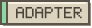

<picture><source media="(prefers-color-scheme: dark)" srcset="assets/hero-night.svg"></picture>

Welcome to Mai-with-u Organization · Home of MaiBot · Powerful QQ Bot Framework · Join us to build better bots

  
  
  
  
  

<picture><source media="(prefers-color-scheme: dark)" srcset="assets/sec-core-night.svg"></picture>

<table align="center">
  <tr>
    <td align="center" valign="top" width="870">
      <picture><source media="(prefers-color-scheme: dark)" srcset="assets/tag-core-night.svg"></picture>
      <h3><a href="https://github.com/Mai-with-u/MaiBot">MaiBot</a></h3>
      我们的组织中心仓库，最核心的 QQ 机器人框架  
      
      
      
    </td>
  </tr>
</table>

<picture><source media="(prefers-color-scheme: dark)" srcset="assets/sec-eco-night.svg"></picture>

<table align="center">
  <tr>
    <td align="center" valign="top" width="430">
      <picture><source media="(prefers-color-scheme: dark)" srcset="assets/tag-adapter-night.svg"></picture>
      <h3><a href="https://github.com/Mai-with-u/MaiBot-SnowLuma-Adapter">SnowLuma Adapter</a></h3>
      QQ 适配器组件  
      
      
    </td>
    <td align="center" valign="top" width="430">
      <picture><source media="(prefers-color-scheme: dark)" srcset="assets/tag-adapter-night.svg"></picture>
      <h3><a href="https://github.com/Mai-with-u/MaiBot-QQ-Adapter">QQ Adapter</a></h3>
      QQ 官方平台适配器  
      
      
    </td>
  </tr>
  <tr>
    <td align="center" valign="top" width="430">
      <picture><source media="(prefers-color-scheme: dark)" srcset="assets/tag-mc-night.svg"></picture>
      <h3><a href="https://github.com/Mai-with-u/MaiCraftMod">MaiCraftMod</a></h3>
      麦麦玩 MC  
      
      
    </td>
    <td align="center" valign="top" width="430">
      <picture><source media="(prefers-color-scheme: dark)" srcset="assets/tag-vtuber-night.svg"></picture>
      <h3><a href="https://github.com/Mai-with-u/Amaidesu">Amaidesu</a></h3>
      麦麦当 VTuber  
      
      
    </td>
  </tr>
  <tr>
    <td align="center" valign="top" colspan="2">
      <picture><source media="(prefers-color-scheme: dark)" srcset="assets/tag-docs-night.svg"></picture>
      <h3><a href="https://github.com/Mai-with-u/docs">Documentation</a></h3>
      麦麦文档仓库  
      
      
    </td>
  </tr>
</table>

<picture><source media="(prefers-color-scheme: dark)" srcset="assets/sec-plugin-night.svg"></picture>

<table align="center">
  <tr>
    <td align="center" valign="top" width="870">
      <picture><source media="(prefers-color-scheme: dark)" srcset="assets/tag-plugin-night.svg"></picture>
      <h3><a href="https://github.com/Mai-with-u/plugin-repo">Plugin Repo</a></h3>
      MaiBot 插件中心仓库  
      
      
    </td>
  </tr>
</table>

<picture><source media="(prefers-color-scheme: dark)" srcset="assets/sec-stats-night.svg"></picture>

  
  
  
  

<picture><source media="(prefers-color-scheme: dark)" srcset="assets/sec-tech-night.svg"></picture>

  
  

<picture><source media="(prefers-color-scheme: dark)" srcset="assets/sec-contrib-night.svg"></picture>

感谢所有为 MaiBot 做出贡献的开发者！

  

  Built with love by <a href="https://github.com/Mai-with-u">Mai-with-u Team</a>

